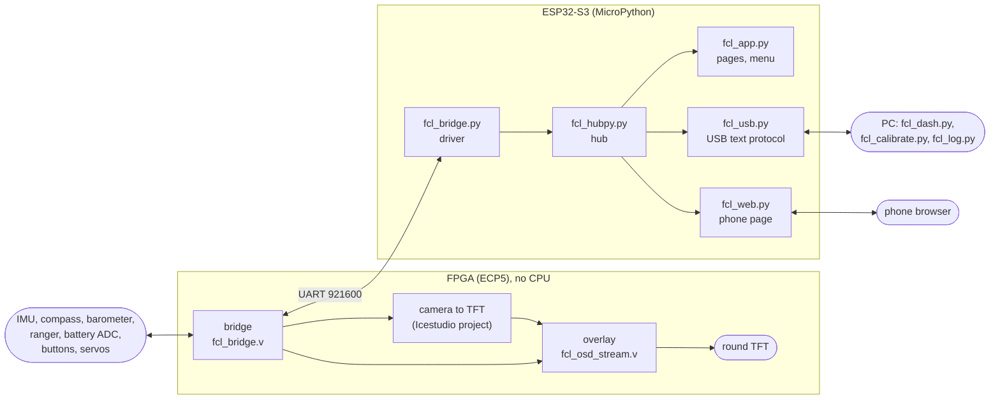

# FCL monocular: developer guide

How the software is layered, how to add a page of your own, and where each thing is tested.
The user's view is in [USER_MANUAL.md](USER_MANUAL.md); the USB protocol in [FIRMWARE_GUIDE.md](FIRMWARE_GUIDE.md).

**Status.** All of this runs in the simulator and passes its tests. Nothing has run on a real board, and the
ESP32 files have only run under ordinary Python on a PC (they are written against the MicroPython documentation).

## Layers



| Layer | File | Job |
|---|---|---|
| FPGA bridge | `fpga/bridge/fcl_bridge.v` | reads the sensors on its own clock and time-stamps them, drives servos and outputs, writes the overlay memory; one command frame in, one answer out |
| FPGA overlay | `fpga/osd/fcl_osd.v`, `fcl_osd_stream.v` | 30 x 15 characters and the down dot over the video on its way to the panel |
| FPGA top | `fpga/full/fcl_top.v` | the camera design + overlay + bridge in one bitstream |
| Driver | `firmware/esp32/fcl_bridge.py` | the bridge's commands as Python calls |
| Hub | `fcl_hubpy.py` with `fcl_fix.py` (attitude filter, viper), `fcl_magcal.py` (compass), `fcl_cfg.py` (calibration values), `fcl_calc.py` (charge, dot, overview text) | turns samples into heading, pitch, roll, height, distance, charge; owns the keys, servos and the screen text |
| **Apps** | **`fcl_app.py`** | **the pages (Level, Height, Bearing, yours), the menu, and the `Unit` calls they use** |
| Outside world | `fcl_usb.py` (USB lines), `fcl_web.py` (phone page), `fcl_usbdev.py` (the ESP32's main loop, Wi-Fi, audio, log file) | |

A page never talks to a sensor or to the FPGA. It asks the `Unit` for readings and gives back lines of text.

## A page of your own

A page is a class with four optional methods. This is the whole of `firmware/esp32/fcl_user_example.py`, a climb
meter:

```python
import fcl_app

class Climb(fcl_app.App):
    name = "CLIMB"

    def __init__(self):
        self.t0 = None           # start time in ms while running
        self.h0 = 0.0
        self.done = None         # (metres, seconds) of the last climb

    def start(self, unit):       # the page has just been selected
        self.t0 = self.done = None

    def button(self, unit):      # B2
        if self.t0 is None:
            self.t0, self.h0, self.done = unit.time_ms(), unit.height(), None
            unit.beep()
        else:
            self.done = (unit.height() - self.h0, (unit.time_ms() - self.t0) / 1000.0)
            self.t0 = None
            unit.say("climb %+.1f m in %.0f s" % self.done)
            unit.beep(1320)

    def draw(self, unit, put):   # 20 times a second
        put(fcl_app.T_ROW, self.name)
        ...                      # put(row, text) writes a centred line

def setup(apps):
    apps.add(Climb())
```

Try it on a PC:

```
python firmware/sim/fcl_sim.py --user fcl_user_example --web 8080
```

Open `http://127.0.0.1:8080`, press **B1 page** until CLIMB shows, then **B2 action**. On the unit: copy your file
to the ESP32 as `fcl_user.py`; `fcl_usbdev.py` calls its `setup(apps)` at start. A mistake in it is reported on the
USB port (`$I,fcl_user.py stopped: ...`) and the unit carries on without it.

### What a page gets

| Method | Called | Use it for |
|---|---|---|
| `start(unit)` | the page is selected (B1, `mode n`) | reset your state |
| `stop(unit)` | another page is selected | release what you held (a servo, a pan) |
| `button(unit)` | B2 is pressed on your page | your action |
| `draw(unit, put)` | every telemetry frame, 20 per second | `put(row, text)`: a centred line, 30 characters at most |

Rows for a page: `T_ROW` 4 (title), `V_ROW` 5, `V2_ROW` 8, `H_ROW` 9 (hint). The other rows belong to the Overview
text, which stays on screen under your page. The screen is round: rows 4 to 10 show 24 or more characters, row 1
about 18, row 0 about 10.

### The `Unit` calls

| Call | Gives / does |
|---|---|
| `unit.heading()`, `unit.pitch()`, `unit.roll()` | degrees; heading 0 = north, clockwise; pitch + = lens up; roll + = right side down |
| `unit.height()` | metres above the last zero (barometer) |
| `unit.pressure()` | hPa |
| `unit.distance()` | metres from the ranger, or `None` when nothing is in reach (about 4 m) |
| `unit.cells()` | `[(millivolts, percent or None, degrees C)]` for the three cells |
| `unit.time_ms()` | the unit's clock, milliseconds |
| `unit.servo(n, us)` | servo 1..6, pulse 500..2500, 0 = off |
| `unit.follow(on)`, `unit.pan(heading or None)` | level servo; servo 2 holds a heading |
| `unit.zero()`, `unit.view(edges)`, `unit.overlay(mask)` | zero the height; camera or edge picture; Overview items |
| `unit.beep(hz, ms)` | a tone on the speaker |
| `unit.say(text)` | one `$I,text` line on the USB stream and in the log |

### Rules that keep the unit responsive

- `draw` runs 20 times a second between sensor frames. Keep it to arithmetic and a few `put` calls: no loops over
  history, no file access, no waiting.
- Do not call the bridge driver from a page. `Unit` calls are safe: the hub sends commands to the FPGA only from
  its `tick_ms`, never while frames are being read (a command sent then would be answered out of order).
- Readings can be `None` before the first frame; `button` and `draw` are only called once there is telemetry.
- Text is ASCII 32..126: that is what the FPGA's font has.

## Keys and the menu

`fcl_hubpy.Hub._inputs` only notes key changes; `tick_ms` turns them into `"B1"`, `"B2"` or `"B1L"` (B1 held 0.7 s;
B1 acts on release so that holding it can mean something else) and hands them to `Apps.key`. The menu is a tuple of
`(label function, action function)` in `Apps.__init__`: add a pair to add an item.

In the full FPGA design B1 and B2 are also wired to the camera design's own keys (view, threshold). At start the hub
sets OUT bit 7, which hands the two buttons to the ESP32; from then on the hub presses the video keys itself
(OUT bits 4, 5, 6, held 100 ms each). If the ESP32 never starts, B1 and B2 work the picture directly, as in the
camera-only design. The video logic only has a toggle for the view, so the hub keeps count of which view is on.

## Calibration values

`fcl_cfg.py` holds the names, defaults and limits (the table at its top). The hub applies them where a reading is
made. To add one: a row in `DEFAULTS`, a use in `fcl_hubpy.py`, and if a person has to measure something, a step
in `firmware/tools/fcl_calibrate.py` (a function that returns `[(name, ok, text)]`, plus an entry in `RUN` and
`STEPS`, plus what the simulated user does for it in `DemoUser`).

## The phone page

`fcl_web.py` is one file: a non-blocking HTTP server polled from the main loop and the page as a string. `GET /s`
returns the state as JSON, `POST /c` takes one command line. Only the commands in `ALLOWED` are taken, because the
page has no password. The page polls `/s` three times a second; there is no websocket.

## FPGA builds

| Bitstream | Build | What |
|---|---|---|
| full | `python fpga/full/build_full.py` | camera to TFT + overlay + bridge: the unit's bitstream |
| bridge | `python fpga/bridge/build_bridge.py` | the bridge alone: first bring-up of sensors, buttons, servos |
| camera | `python fpga/build.py` | the Icestudio camera project alone |

`python fpga/make_prebuilt.py` builds all three, runs the tests and stores the results with checksums in
`fpga/prebuilt/`; `--check` rebuilds and compares.

The full design takes the generated `main.v` unchanged. `build_full.py` writes `fcl_cam.v`, the same module with the
port names of the `.ice` file, and the pin file from the `.ice` pins plus `firmware/hub/fcl_hub_pins.lpf`. The
overlay sits between the camera design's LCD outputs and the pins; it recovers the pixel position from DE and VS
and delays the sync signals by its own three clocks. The pixel clock is the camera design's `debug-OUT` output.

## Tests

| Test | Covers | Run |
|---|---|---|
| `test_app.py` | pages, the three tools, the menu, `$L` lines, logging, calibration values, pan hold, the example page | `python firmware/sim/test_app.py` |
| `test_web.py` | the phone page over real sockets: page, state, commands, refusals, a silent client | `python firmware/sim/test_web.py` |
| `test_calibrate.py` | the guided calibration against simulated hardware with errors built in | `python firmware/sim/test_calibrate.py` |
| `test_usb.py` | the USB stream: every older command, buttons, Wi-Fi, audio, overlay | `python firmware/sim/test_usb.py` |
| `test_filter.py`, `test_magcal.py` | attitude filter; compass calibration | `python firmware/sim/test_filter.py`, `test_magcal.py` |
| `test_bridge.py` | `fcl_bridge.v` in Icarus Verilog against the Python model | `python fpga/bridge/test_bridge.py` |
| `test_osd.py` | the overlay pixel for pixel, alone and behind `fcl_osd_stream.v` with video timing and a second clock | `python fpga/osd/test_osd.py` |

What the simulator is: the ESP32 files run as they are, on a Python model of the bridge that is checked frame by
frame against the Verilog, on register-level models of the sensors. What it cannot show: timing and memory on the
real ESP32, MicroPython differences, real sensor behaviour, and the FPGA on a board.

## Not done

- Soft-iron correction of the compass.
- The full FPGA design has been built, and its overlay stage simulated; the whole design has not been simulated
  together or loaded into a board.
- **Timing of the camera design's memory clock.** The camera design's SDRAM clock runs at 142.9 MHz and nextpnr estimates 70 MHz for its slowest path (2 ns of logic, 12 ns of routing). The 25 MHz clock (bridge) and the
  18 MHz pixel clock (overlay) pass with margin. This is in the Icestudio camera project, not in the bridge or the
  overlay; earlier builds reported "timing met" only because no clock frequency was given to the tool. It may
  still work on a board (the estimate is cautious), but a picture with random wrong pixels would point here. Ways
  out: a lower SDRAM clock with the controller's wait counts adjusted, or placing the SDRAM logic near its pins.
- A password or pairing for the phone page.
- Audio and the phone page at the same time have not been tried on the ESP32.
