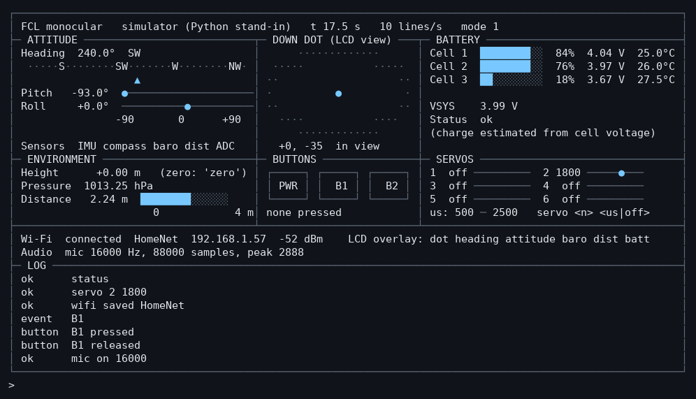
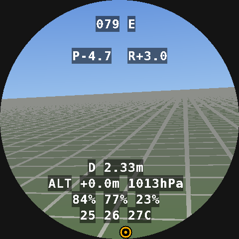
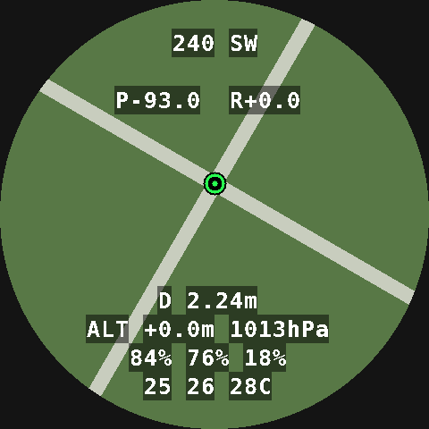
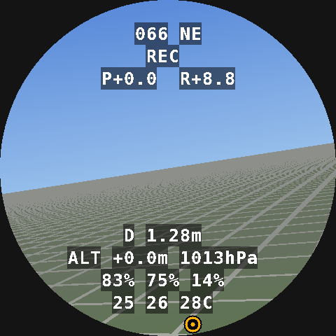
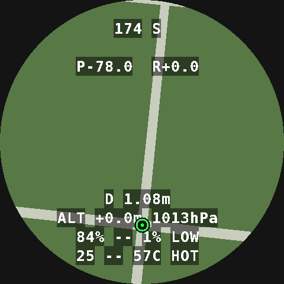
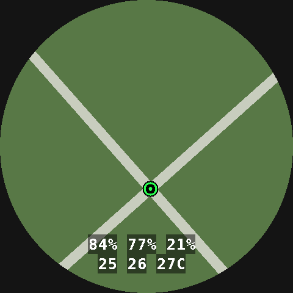

# Firmware guide: USB stream, dashboard, LCD overlay, simulator

Generated by `python firmware/tools/make_docs.py` from a run of the simulator (hub back end: Python stand-in). Do not edit by hand: change the firmware or the generator and run it again.

**Status.** Everything here runs today in the simulator and passes its tests. Nothing has run on a real board: the boards are not built, the hub CPU inside the FPGA is not built, and the ESP32 code is written against the MicroPython documentation only. See "What is tested and what is not" at the end.

## Try it without hardware

```
python firmware/tools/fcl_dash.py --sim
```

That starts a simulated unit and the dashboard on it. It needs Python 3 only. Type commands at the bottom (`help` lists them); Esc quits. The simulated unit runs a 60 second loop: it pans, looks straight down, tilts, climbs 3 m, has its buttons pressed, and its cells slowly run down.

To serve the same stream on a TCP port (for your own programs): `python firmware/sim/fcl_sim.py`, then `python firmware/tools/fcl_dash.py --tcp 127.0.0.1:7007`.

With a real unit on USB: `python firmware/tools/fcl_dash.py --port COM7` (Linux: `/dev/ttyACM0`; needs `pip install pyserial`).

## The dashboard



| Panel | Shows |
|---|---|
| ATTITUDE | compass heading with a moving tape, pitch and roll, and which sensors answered |
| DOWN DOT | the round LCD in miniature with the dot where the unit draws it: `●` in view, `◆` on the rim |
| BATTERY | per cell: charge bar and percent, voltage, temperature; VSYS; LOW / CUTOFF / HOT |
| ENVIRONMENT | height since power-up or the last `zero`, air pressure, distance from the laser ranger |
| BUTTONS | the three buttons, lit while held |
| SERVOS | the pulse width last commanded over USB for each of the six outputs |
| Wi-Fi / Audio | connection state and address; microphone stream statistics |
| LOG | replies to commands, button presses, events from the hub |

Local commands of the dashboard: `!log file.csv` writes the telemetry to a CSV file, `!wav file.wav` records the microphone stream, `!play file.wav` sends a 16-bit mono WAV file to the speaker.

## The LCD overlay and the down dot

The same data can be drawn over the camera picture on the round LCD. The pictures below are the overlay exactly as the hub composes it (text grid and dot position), on a stand-in camera picture.

| | LCD | What to notice |
|---|---|---|
| **Level, panning** |  | Held level, the point straight below is far outside the picture, so the dot sits on the rim at the bottom, amber, showing which way down is. |
| **Pointing straight down** |  | Pointed at the ground, the dot turns green and moves into the picture; when it sits on the centre cross the lens points exactly down. |
| **Tilted, recording** |  | B2 was pressed at 30 s (recording on, REC on the LCD); B1 is being held, which the BUTTONS panel and the $B lines show. |
| **A low cell, a hot cell, an empty slot** |  | Cell 3 is under 3.40 V (LOW), over 55 C (HOT), and slot 2 has no cell. The dot is in view below the centre: the lens is 12 degrees short of straight down. |
| **Overlay reduced to the dot and the charge** |  | `overlay dot batt` leaves only the dot and the charge rows on the LCD. |

**The down dot.** The hub works out where "straight down" is from the accelerometer, gyro and compass, and marks that point in the picture. Green with a ring: the point is in view. Amber on the rim: it is outside the picture, in that direction. On the centre: the lens points straight down. The picture is assumed to span 40 degrees across the LCD (`CAM_HFOV_DEG` in `firmware/common/board.h`): measure the real lens and set it, or the dot will be off away from the centre.

**Text rows.** Heading and compass point; REC while recording; pitch and roll; distance; height and pressure; charge of the three cells (with LOW or OFF); cell temperatures (with HOT). `overlay` chooses the items:

| Item | Bit | Shows |
|---|---|---|
| `dot` | 0x01 | the down dot |
| `heading` | 0x02 | heading row |
| `attitude` | 0x04 | pitch / roll row |
| `baro` | 0x08 | height and pressure row |
| `dist` | 0x10 | distance row |
| `batt` | 0x20 | charge and temperature rows |

In the FPGA the overlay is `fpga/osd/fcl_osd.v` (30 x 15 characters of 16 x 32 pixels, font in `font16x32.hex`). `python fpga/osd/test_osd.py` checks that it produces the same pixels as these pictures. It is not yet part of the camera design: the hub CPU that feeds it has to be built first.

## The USB serial stream

The unit appears as a serial port. It sends text lines; each starts with `$` and a letter. Commands are plain words, one per line. An excerpt (`>` marks lines sent to the unit):

```
$T,100,31.20,0.63,0.57,0.00,1013.25,1543,4050,3980,3700,4000,25.0,26.0,27.0,85,77,25,0,2,226,0,63,8,31
$T,200,32.40,1.24,1.11,0.00,1013.25,1586,4050,3980,3700,4000,25.0,26.0,27.0,85,77,25,0,4,226,0,63,8,31
...
$I,FCL USB protocol 1 (simulator, Python stand-in)
> servo 2 1800
$S,0,1800,0,0,0,0
$R,ok,servo 2 1800
> overlay dot batt heading
$R,ok,overlay 0x23
> wifi HomeNet secretpass
$W,connecting,HomeNet,,0
$R,ok,wifi saved HomeNet
$E,B1
$B,B1,1
$W,connected,HomeNet,192.168.1.57,-52
$B,B1,0
> zero
```

| Line | Meaning |
|---|---|
| `$T,...` | telemetry, fields below; 10 per second by default (`stream`) |
| `$E,<name>` | event from the hub: B1, B2, PWR_SHORT, PWR_OFF, CELL_LOW, CELL_CUTOFF |
| `$B,<button>,<0/1>` | button released / pressed: PWR, B1, B2 |
| `$S,<us1>..<us6>` | servo pulse widths last commanded over USB, 0 = off |
| `$W,<state>,<ssid>,<ip>,<rssi>` | Wi-Fi: off, connecting, connected, failed; sent every 5 s and on change |
| `$A,<seq>,<rate>,<base64>` | microphone audio: 16-bit little-endian mono PCM, 50 ms per line in the simulator |
| `$R,ok/err,<text>` | reply to a command |
| `$I,<text>` | information: version, help, scan results |

**Telemetry fields, in order:**

| # | Field | Unit / meaning |
|---|---|---|
| 1 | `t_ms` | ms since the hub started |
| 2 | `heading` | degrees, 0 = north, clockwise |
| 3 | `pitch` | degrees, + lens up |
| 4 | `roll` | degrees, + right side down |
| 5 | `alt_m` | m above the power-up point or the last `zero` |
| 6 | `press_hpa` | hPa |
| 7 | `dist_mm` | mm (valid when flags bit 3 is set) |
| 8 | `cell1_mv` | mV |
| 9 | `cell2_mv` | mV |
| 10 | `cell3_mv` | mV |
| 11 | `vsys_mv` | mV |
| 12 | `temp1_c` | C, cell 1 |
| 13 | `temp2_c` | C, cell 2 |
| 14 | `temp3_c` | C, cell 3 |
| 15 | `soc1` | percent, from the cell voltage; 255 = no cell |
| 16 | `soc2` | percent |
| 17 | `soc3` | percent |
| 18 | `buttons` | bit 0 PWR, bit 1 B1, bit 2 B2 (1 = held) |
| 19 | `dot_x` | LCD pixels from the centre, + right |
| 20 | `dot_y` | LCD pixels from the centre, + down |
| 21 | `mode` | display mode 0-3 (B1 steps it) |
| 22 | `overlay` | overlay item bits |
| 23 | `flags` | 1 REC, 2 cell low, 4 cutoff, 8 distance valid, 16 hot, 32 dot in view |
| 24 | `sensors` | bit 0 IMU, 1 compass, 2 barometer, 3 distance, 4 ADC answered |

**Commands:**

| Command | Does |
|---|---|
| `help` | this list |
| `status` | one $T line, $S, $W and the version |
| `stream on|off|<hz>` | telemetry lines per second (1-20), default 10 |
| `servo <1-6> <us|off>` | servo pulse 500-2500 us; servo 1 stops following pitch |
| `follow on|off` | servo 1 holds the camera level (pitch) |
| `mode <0-3>` | display mode (same as B1) |
| `overlay <items>|<mask>` | LCD overlay: dot heading attitude baro dist batt | all | none | number |
| `zero` | make the present height 0 |
| `wifi <ssid> <password>` | save the network and connect;  wifi status | scan | off |
| `mic on|off [rate]` | microphone to $A lines (8000 or 16000 Hz) |
| `spk <rate> <base64>` | play 16-bit mono PCM on the speaker;  spk off |
| `tone <hz> <ms>` | test tone on the speaker |
| `repl` | leave the stream and go back to the MicroPython prompt |

**Charge (SOC).** Estimated from each cell's voltage with a table for a typical 18650 (4.20 V = 100 %, 3.80 V = 50 %, 3.30 V = 0 %), smoothed over about 2 s. Under load a cell reads lower, so the figure drops when the unit works hard and recovers at rest. It is a gauge, not a counter of charge.

**Audio over USB.** Sound travels inside the serial stream as base64 text (`$A` lines out, `spk` lines in). The unit is not a USB sound card: MicroPython on the ESP32 has no USB audio class. The microphone and the speaker amplifier share their clock pins, so one runs at a time.

**Wi-Fi over USB.** `wifi <ssid> <password>` writes the network into `wifiman.conf` (the file esp32ecp5 already uses) and connects; the `$W` line shows the address for FTP and bitstream upload.

## How the pieces fit

```
 sensors, buttons, ADC, servos            FPGA (ECP5)                       ESP32-S3                 PC
 ------------------------------   -------------------------------   ----------------------   ----------------
 IMU, compass, barometer,    -->  hub CPU: firmware/common          fcl_hub.py   link frames
 laser ranger (I2C)               fusion, charge, down dot,   UART  fcl_usb.py   text lines   USB  fcl_dash.py
 cell voltages, NTCs (ADC)        overlay text, commands     <--->  fcl_usbdev.py Wi-Fi,     <---> your own
 B0 B1 B2, 6 servo outputs        fpga/osd/fcl_osd.v -> LCD         audio (I2S)               programs
```

In the simulator the left column is replaced by sensor models (`firmware/sim/sim.c`) and the ESP32's Wi-Fi and audio by stand-ins; `firmware/common`, `fcl_hub.py` and `fcl_usb.py` are the same files the unit runs.

## Increments

| # | Increment | State |
|---|---|---|
| 1 | Hub: sensors, attitude filter, battery limits, buttons, link frames | simulated, tested (earlier work) |
| 2 | Hub: charge percent, cell temperatures, button states, down dot, overlay text, new commands | simulated, tested |
| 3 | USB text protocol (`fcl_usb.py`): telemetry, servo, mode, overlay, zero, stream rate | simulated, tested |
| 4 | Buttons, Wi-Fi setup and audio over the USB stream | protocol tested in the simulator; ESP32 code (`fcl_usbdev.py`) not run on hardware |
| 5 | Terminal dashboard (`fcl_dash.py`) | works on the simulator; serial port path not tried on hardware |
| 6 | LCD overlay in the FPGA (`fcl_osd.v`) | Verilog simulated, identical pixels to the Python overlay; not in the camera design yet |
| 7 | Hub CPU in the FPGA (soft RISC-V, I2C / SPI / UART / PWM / overlay registers) | not started: needed before any of this runs on a board |
| 8 | Bring-up on the real board: sensor axes, lens angle, NTC constants, charge table against real cells | waits for boards |

## What is tested and what is not

| Test | Covers | Run |
|---|---|---|
| `fcl_sim` | the hub firmware against sensor models: attitude accuracy, height, charge, buttons, commands, power-off (21 checks) | `make -C firmware/sim test` (needs a C compiler) |
| `test_link_py.py` | the ESP32's frame decoder on the bytes the hub sent | `python firmware/sim/test_link_py.py link.bin` |
| `test_usb.py` | the USB stream end to end: every command, buttons, Wi-Fi, audio, overlay equality (20 checks per hub back end) | `python firmware/sim/test_usb.py` |
| `test_osd.py` | `fcl_osd.v` pixel for pixel against the Python overlay, 5 frames | `python fpga/osd/test_osd.py` (needs Icarus Verilog) |

Not tested, because it needs hardware: the ESP32 code that touches pins (I2S audio, Wi-Fi, the UART to the FPGA, USB serial timing), real sensors (the drivers follow the datasheets; values marked CHECK in `firmware/common/board.h` are assumptions), and the whole FPGA side beyond the overlay module.
