# FCL monocular: user manual

How to use the unit: buttons, the screen, the measuring pages, the menu, the phone page, logging, updates and
calibration. One page to start from: [QUICK_START.md](QUICK_START.md). When something does not work:
[TROUBLESHOOTING.md](TROUBLESHOOTING.md). The USB protocol in full: [FIRMWARE_GUIDE.md](FIRMWARE_GUIDE.md).
Writing your own pages and scripts: [DEVELOPER_GUIDE.md](DEVELOPER_GUIDE.md).

**Status.** Everything described here runs in the simulator and passes its tests. No board has been built yet, so
nothing here has run on real hardware. The pictures are made by the simulator (`python firmware/tools/make_manual.py`):
the text, the graphics and the dot are what the unit's software put on the screen; the camera picture behind them
is a stand-in.

Try it on a PC, no hardware needed (Python 3 only):

```
python firmware/sim/fcl_sim.py --web 8080          then open http://127.0.0.1:8080
python firmware/tools/fcl_dash.py --sim            the same unit as a text dashboard
```

## Buttons

| Button | Press | Hold |
|---|---|---|
| **PWR** (B0) | reported to the PC (`PWR_SHORT`); no action on the unit | 2 s: switch off. 8 s: the FPGA switches off even if the ESP32 has stopped |
| **B1** | next page: Overview, Level, Height, Bearing, Survey, then your own pages | 0.7 s: open or close the menu |
| **B2** | the page's action (see each page). On the Overview: recording mark (REC) on / off | |

In the menu, B1 moves down the list and B2 selects.

The same buttons exist on the phone page and as USB commands (`key B1`, `key B2`, `key B1L` for B1 held).

## The screen

| Overview | What the rows are |
|---|---|
| 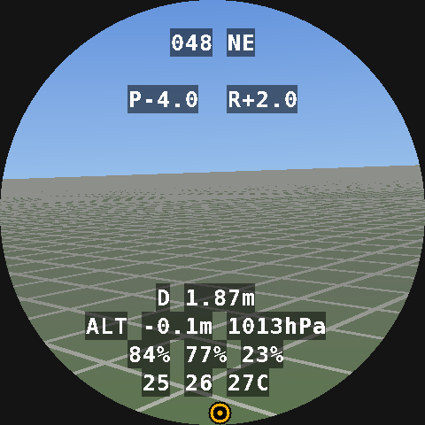 | **048 NE** heading in degrees and compass point. **P / R** pitch and roll in degrees (+ is lens up, right side down). **D** distance from the laser ranger. **ALT** height since switch-on or the last zero, and air pressure. Charge of the three cells in percent, then their temperatures. The **dot** marks where straight down is: green inside the picture, amber on the rim when down is outside the picture. |

Warnings appear next to the charge and temperature rows: `LOW` (a cell under 3.40 V), `OFF` (under 3.20 V), `HOT`
(over 55 C). `REC` shows under the heading while the recording mark is on.

### Graphics

| | |
|---|---|
| 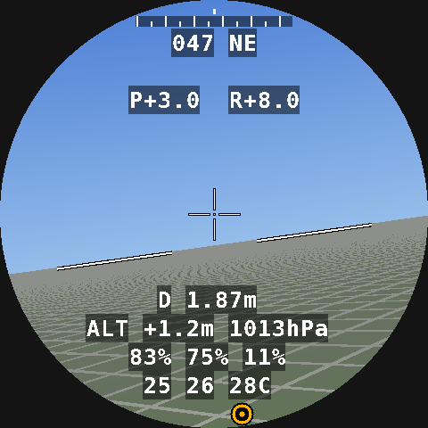 | Three things can be drawn under the text. **Reticle:** a cross at the centre of the picture, the point the measuring pages aim with. **Horizon:** a line that stays level with the ground as you tilt and roll the unit (it leaves a gap round the centre, and goes away when the horizon is out of the picture). **Compass tape:** ticks at the top, a short one every 5 degrees and a tall one every 10, sliding past a fixed pointer as you turn; a tall tick is under the pointer when the heading is a multiple of 10. |

Each page switches on what it needs: Level the reticle and the horizon, Height the reticle, Bearing and Survey the
reticle and the tape. To have them on every page, use the menu item **Graphics** (page / reticle / all) or the
command `hud reticle horizon tape` (`hud off` goes back to what the page asks for). Nothing is drawn while the menu
is open.

## Pages

### Level

| | |
|---|---|
| 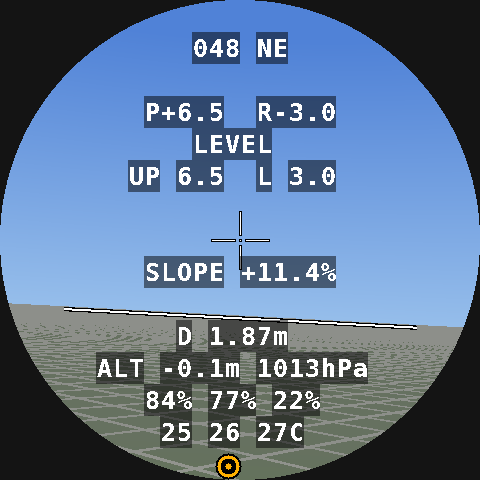 | Pitch as UP / DN, roll as L / R, and the slope in percent. |
| 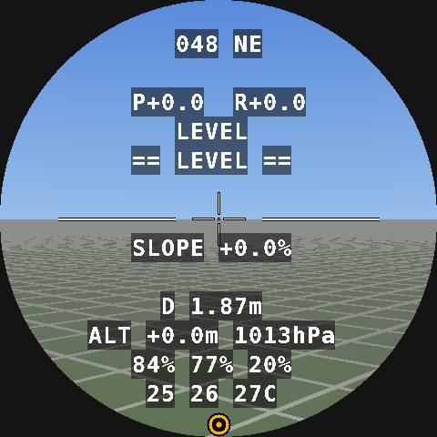 | `== LEVEL ==` when both are within half a degree. |

Put the unit on a surface, or sight along something. Run the `level` step of the calibration first (see below),
or the reading includes the mounting error of the sensor board.

### Height of an object

Two sightings: the foot, then the top.

| Step | Screen |
|---|---|
| 1. Aim the reticle at the **foot** of the object. The ranger must reach it (`D` shows a distance). Press B2. | 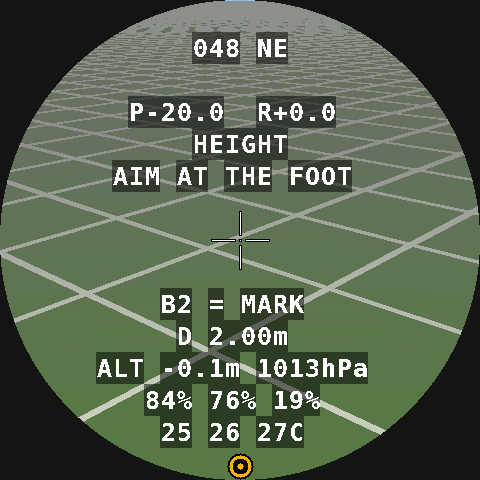 |
| 2. Tilt up to the **top**. The height updates as you tilt. Press B2 to hold the result. | 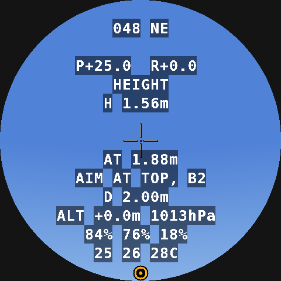 |
| 3. `H` is the height, `AT` the horizontal distance to the object. B2 starts again. | 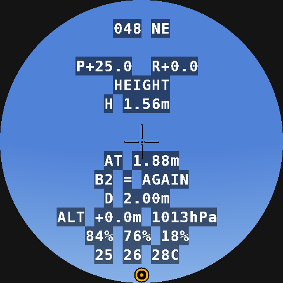 |

Limits: the ranger reaches about 4 m, so you must stand within about 4 m of the foot; the top may be any height
(it is worked out from the angle). Stand still between the two sightings. The object is taken to be vertical.

### Bearing

| | |
|---|---|
| 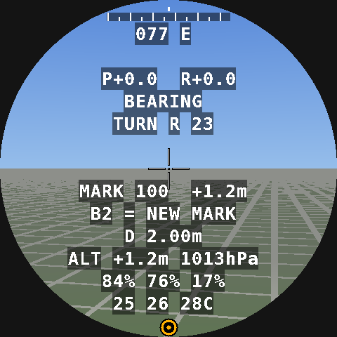 | Aim at something and press B2: the unit remembers the heading and your height. Afterwards it shows which way and how far to turn to face it again (`ON MARK` within 2 degrees), the marked heading, and how far you have climbed or dropped since. B2 sets a new mark. |

### Survey

Points around you, from where you stand: for a room, its corners.

| | |
|---|---|
| 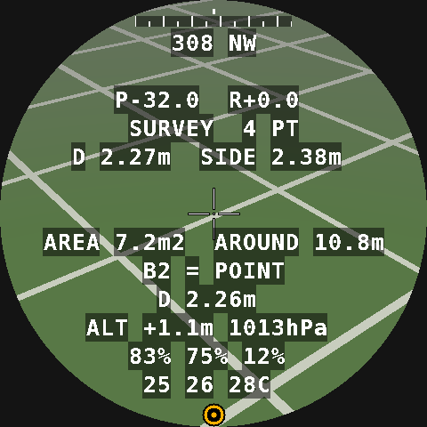 | Aim the reticle at a corner and press B2; go round the corners in order. Each point is the ranger's distance along the compass heading and the pitch. The page shows the number of points, the distance now, the length of the last side, and from three points on the area on the ground and the way round. `OUT OF RANGE`: the ranger sees nothing there, and B2 stores nothing (low beep). |
| 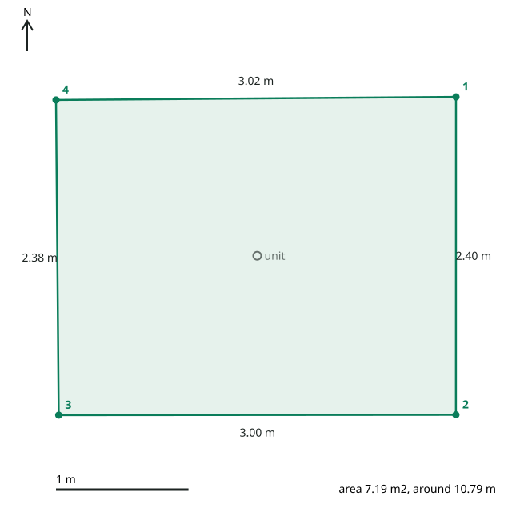 | The same points on a PC: `python firmware/tools/fcl_survey.py --from COM7 --svg plan.svg --csv points.csv` (or give it a log file). It prints a table and draws the plan from above, north up, with the side lengths. |

Stand in one place for the whole survey: the points are measured from the unit. The ranger reaches about 4 m.
The compass is good to a few degrees, which moves a corner by a few centimetres per metre of distance; the lengths
of the sides suffer less than their directions. Up to 60 points are kept until you clear them (menu
**Clear points**, or `points clear`); `points` lists them again. Calibrate the compass first.

## Menu

Hold B1 for 0.7 s. B1 moves down, B2 selects, holding B1 again (or `Exit`) closes it.

| | Item | B2 does |
|---|---|---|
| 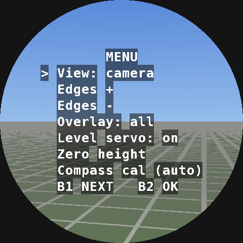 | View: camera / edges | switches the picture between the camera and the edge view |
| | Edges + / Edges - | edge threshold one step up / down |
| | Overlay: all / dot / off | how much of the Overview text is shown |
| | Level servo: on / off | servo 1 holds a camera mount level |
| | Zero height | makes the present height 0 |
| 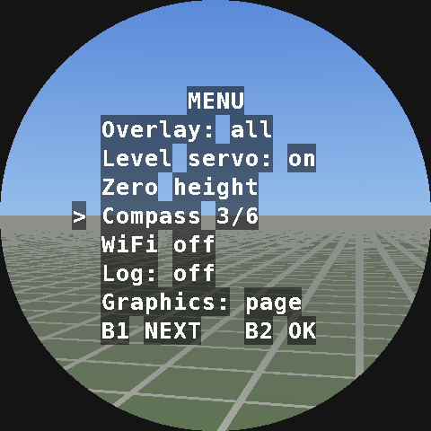 | Compass cal | starts the compass calibration by hand: point the unit up, down and to four sides; the item counts the directions seen (`Compass 2/6`) and finishes by itself |
| | WiFi ... | shows the state or the address; switches Wi-Fi off, or on with the saved network |
| | Log: on / off | records to a file on the unit (see Logging) |
| | Graphics: page / reticle / all | graphics on every page: none beyond what the page asks for, the reticle, or all three |
| | Clear points: n | forgets the Survey page's points |

A new network name and password are set over USB only: `wifi <name> <password>`.

## Phone page

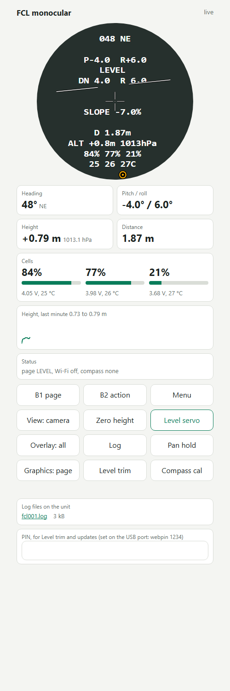

When the unit is on Wi-Fi it serves this page on its address (shown in the menu, and on the `$W` line over USB):
open `http://<address>/` on a phone or PC on the same network. It shows the screen text, the graphics and the dot,
the readings and the cells, the height over the last minute, the three buttons and the everyday switches, and the
log files on the unit (tap one to download it).

**Who can do what.** Anyone on the same network can open the page and press its buttons. Three things need a PIN:
changing calibration values (the **Level trim** button, which makes the present pitch and roll read 0), putting new
files on the unit, and restarting it. Set the PIN once on the USB port, `webpin 1234` (4 to 8 digits; `webpin off`
removes it), and type it into the PIN box on the page: the browser remembers it. With no PIN set, those three
things are refused. Five wrong PINs lock them for a minute. The PIN is sent without encryption: it keeps someone
else on your Wi-Fi from changing the unit, not someone who can listen to the network. Wi-Fi settings, audio and the
Python prompt stay on the USB port. Do not use the page on a network you do not trust.

## Updates over Wi-Fi

New software goes onto the unit from a PC on the same network, without a cable:

```
python firmware/tools/fcl_update.py 192.168.1.57 --pin 1234
python firmware/tools/fcl_update.py 192.168.1.57 --pin 1234 --bit fpga/prebuilt/full/fcl_full.bit --flash
python firmware/tools/fcl_update.py 192.168.1.57 --pin 1234 --user my_page.py
```

The first form sends the Python files of `firmware/esp32` that differ from the unit's and restarts it. `--bit`
also sends the FPGA bitstream and loads it; with `--flash` it is written into the FPGA's own memory, so that it
stays after power-off (about a minute). `--user` stores a page of your own as `fcl_user.py`. `--dry` only shows
what would be sent.

Each file is checked by a checksum on arrival and only then replaces the old one; if a file is refused, nothing is
restarted. If the unit does not come back after an update, the USB port still works: see
[TROUBLESHOOTING.md](TROUBLESHOOTING.md).

## Over USB

The unit appears as a serial port. `python firmware/tools/fcl_dash.py --port COM7` shows everything on one text
screen and takes commands. The commands added by this manual's features:

| Command | Does |
|---|---|
| `mode <n>` | choose a page: 0 Overview, 1 Level, 2 Height, 3 Bearing, 4 Survey |
| `hud reticle horizon tape` / `hud all` / `hud off` | graphics on every page |
| `points` / `points clear` | the Survey page's points |
| `key B1` / `key B2` / `key B1L` | press a button from the PC |
| `view camera` / `view edges`, `threshold up` / `down` | the picture on the screen |
| `pan <degrees>` / `pan here` / `pan off` | servo 2 holds a compass heading |
| `follow on` / `off` | servo 1 holds the camera mount level |
| `log on` / `log off` | record on the unit |
| `cal`, `cal set <name> <value>`, `cal reset` | calibration values |
| `webpin <digits>` / `webpin off` | the PIN for the phone page's protected actions |
| `fpga <file>` / `fpga <file> flash`, `reboot` | load a bitstream file that is on the unit; restart the ESP32 |

From a Python script or notebook the same unit is `firmware/tools/fcl.py`:

```python
import fcl
u = fcl.connect("COM7")              # or "sim": no hardware needed
u.wait(2)
print(u.heading, u.pitch, u.height, u.distance)
u.page("survey"); u.key("B2"); print(u.points())
```

`help` lists all commands; [FIRMWARE_GUIDE.md](FIRMWARE_GUIDE.md) describes the whole protocol.

## Logging and replay

- **On the unit:** `log on` (or the menu) writes telemetry, button presses, events and page results to
  `fclNNN.log`: on the SD card if one is mounted, otherwise in the ESP32's own flash, where it stops at 2 MB
  (about 25 minutes at the default 10 lines per second; `stream 1` makes that about 4 hours).
- **On the PC:** in the dashboard, `!log trip.log` records the same lines from the USB stream.
- **Look at a log:** `python firmware/tools/fcl_log.py trip.log` prints a summary; `--csv trip.csv` writes a table;
  `--plot trip.png` draws it.
- **Replay:** `python firmware/tools/fcl_dash.py --replay trip.log` plays it back on the dashboard
  (`--speed 4` four times as fast).

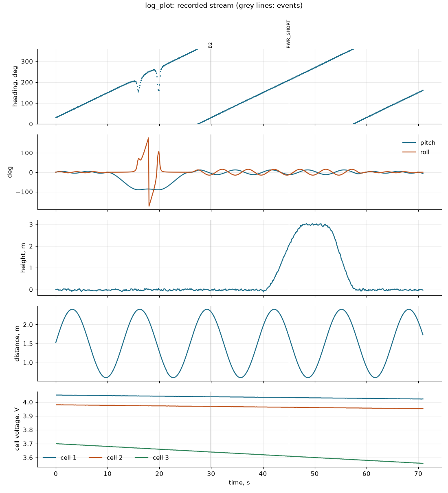

## Calibration

Run once on every new unit:

```
python firmware/tools/fcl_calibrate.py --port COM7
```

It tells you what to do, measures, and stores the result on the unit. You need a level table, a tape measure,
a multimeter, a room thermometer and a landmark of known bearing. Enter skips a question. A measurement that
looks wrong is refused and nothing is stored for it.

| Step | You do | It stores |
|---|---|---|
| compass | point the unit up, down and to four sides | the compass offset (`magcal.json`); reports what is left over |
| axes | hold level, point down, tip right, turn right | nothing: it checks that pitch, roll and heading run the right way |
| level | put the unit on a level table | `pitch0`, `roll0`: how the sensor board sits |
| lens | put a mark in the centre, then tilt until it touches the edge of the screen | `hfov`: the camera's angle, for the down dot |
| distance | aim at a wall and measure to it with a tape | `dist0` |
| cells | measure each cell with a multimeter | `cell1`..`cell3` |
| temps | give the room temperature | `temp1`..`temp3` |
| north | aim at a landmark of known bearing | `head0`: declination and mounting |

`python firmware/tools/fcl_calibrate.py --sim --demo` runs the whole thing in the simulator, on simulated hardware
with errors built in. Its result ([full text](manual/calibration_demo.txt)):

```
  ok    compass                    offset 225, -153, 120 mG, field 475 mG, left over 0.5 % of the field
  ok    axes: level                pitch +3.0, roll -2.0 (both near 0)
  ok    axes: lens down            pitch -87.0 (near -90)
  ok    axes: tipped right         roll +43.0 (near +45)
  ok    axes: quarter turn right   heading changed by +89 (near +90)
  ok    level                      sensor board sits +3.00 deg in pitch and -2.00 deg in roll; stored
  ok    lens                       the screen shows 48.0 deg across; stored
  ok    distance                   ranger read +35 mm against the tape; stored
  ok    cell 1                     unit read +3.0 % against the meter; stored
  ok    cell 2                     unit read -1.5 % against the meter; stored
  ok    temp 2                     sensor read +4.0 C against the room; stored
  ok    temp 3                     sensor read -2.5 C against the room; stored
  ok    north                      heading read -4.4 deg against the map; stored
```

The compass also keeps calibrating itself in use (see the firmware guide). What the calibration does not correct:
"soft iron" (the unit's own steel bending the field, which leaves a heading error that changes with direction).
The compass step reports how much is left over so you can see whether it matters.

## Servos

Six servo outputs. Servo 1 can hold a camera mount level in pitch (`follow on`), servo 2 can hold a compass heading
(`pan 120`, `pan here`, `pan off`). Both move 10 microseconds per degree around 1500, limited to 1000..2000; the
direction and the travel per degree are calibration values (`tilt_us`, `pan_us`; a negative value reverses).
`servo <n> <us>` sets any output directly.

## What is not verified

- Nothing has run on a real board.
- The sensor axis directions, the lens angle (40 degrees assumed until calibrated), the temperature sensor
  constants and the charge table are assumptions. The calibration finds most of them; the charge table needs a
  discharge test of a real cell.
- The height page has only been checked with exact simulated readings. On a real unit its error is set by how
  steadily it is held and by the ranger: expect centimetres, not millimetres.
- The compass next to three steel-cased cells may need the soft-iron correction that does not exist yet.
- The phone page has been tested in a desktop browser against the simulator, and its server under MicroPython on
  a PC, not on the ESP32. Whether the ESP32 has the memory for a 440 kB bitstream upload next to everything else
  has to be tried; the FTP server of esp32ecp5 remains as the other way in.
- The graphics have been checked pixel for pixel in simulation. How well a thin white line with a black edge shows
  on the real panel over a real picture is not known.
- The Survey page has only seen exact simulated readings plus the simulated compass error.
- The log to the SD card assumes the card is mounted at `/sd`; whether the ESP32 can use the card while the FPGA
  is running has to be tried.
