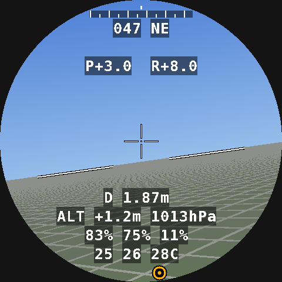
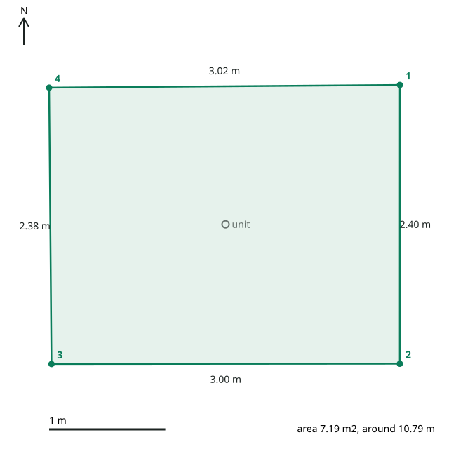

# FCL monocular

A hand-held monocular on one board: an FPGA (ECP5) takes the camera picture to a round 2.1" TFT and draws text and
graphics over it; an ESP32-S3 reads the sensors through the FPGA and runs the pages, the phone page and the USB
port. Three 18650 cells.

**State.** The board is routed and not yet ordered. The FPGA design and the software are written and tested in
simulation only; nothing here has run on hardware.



## Try it now, without hardware

Python 3 on any PC:

```
python firmware/sim/fcl_sim.py --web 8080
```

then open `http://127.0.0.1:8080`: the unit's screen, its buttons and its readings.

## Read

| | |
|---|---|
| [Quick start](doc/QUICK_START.md) | one page |
| [User manual](doc/USER_MANUAL.md) | the screen, the pages, the phone page, updates, logging, calibration |
| [Troubleshooting](doc/TROUBLESHOOTING.md) | by symptom |
| [Six lessons](doc/lessons/README.md) | measuring with angles, a compass and a ranger; a first page of your own |
| [Developer guide](doc/DEVELOPER_GUIDE.md) | layers, your own pages, scripting, FPGA builds, tests |
| [Firmware guide](doc/FIRMWARE_GUIDE.md) | the USB protocol, with pictures from a simulator run |
| [Bring-up checklist](doc/BRINGUP.md) | first power-up of a new board |
| [Roadmap](ROADMAP.md) | decisions, dated log, open items |
| [Repository](https://github.com/jharvey/FPGA_CAM-LCD) | all files |


